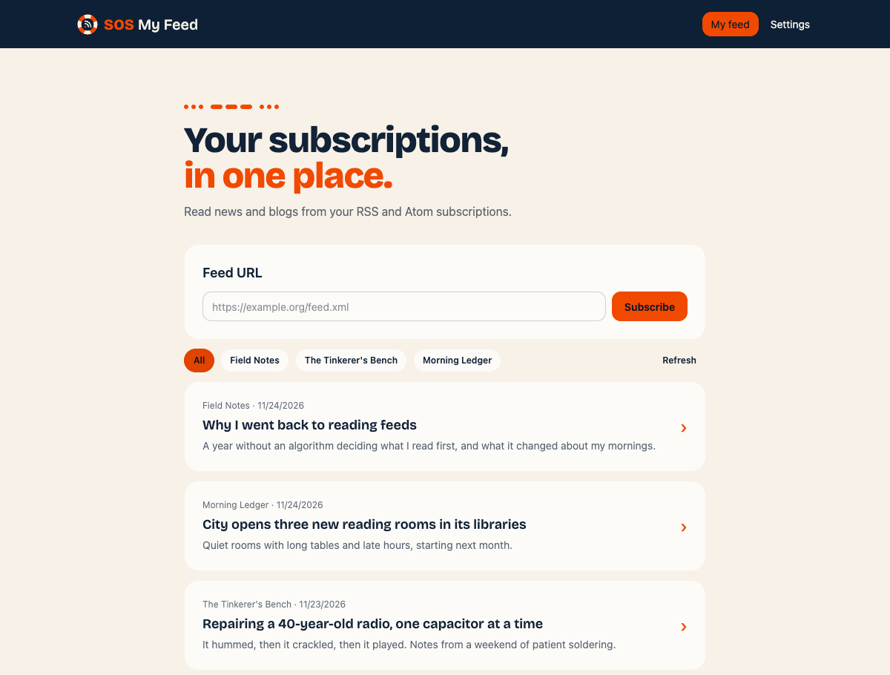
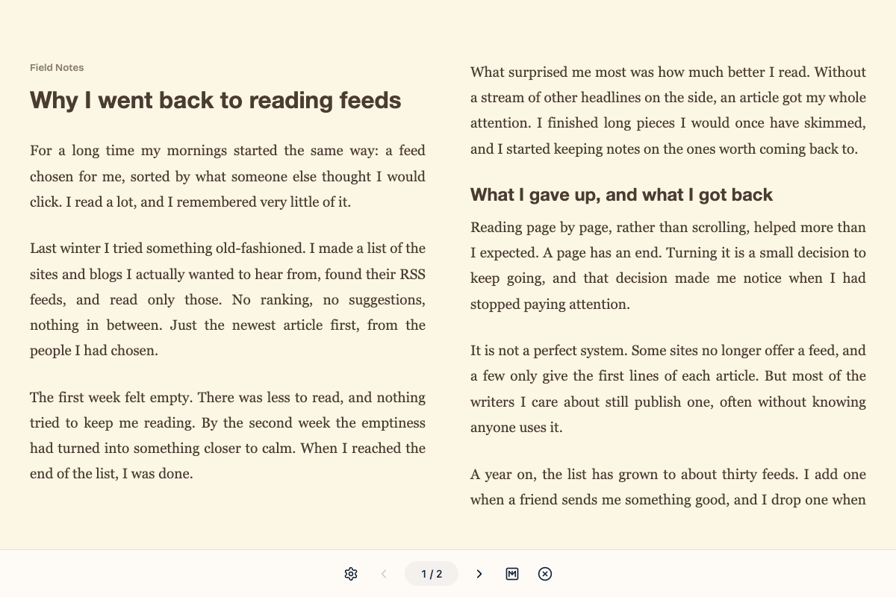

# SOS My Feed

**English** | [한국어](README.ko.md)

[](https://github.com/gyedongjeon/sos-my-feed/releases/latest)
[](https://github.com/gyedongjeon/sos-my-feed/actions/workflows/ci.yml)
[](LICENSE)

Too many tabs? A reader for the **RSS and Atom feeds of the news sites and blogs you follow**,
running on your own machine. Subscribe to a feed, see every new article in one list, and read
an article inside the app, page by page.



Part of the SOS series, next to [SOS My Language](https://github.com/gyedongjeon/sos-my-language).

## Features
- **Popular feeds to start from**: 803 feeds in all 19 languages of the pages: well-known news sites by topic (top stories, world, business, technology, science, sports, culture), among them the English editions of outlets from Europe, Korea, Japan, and elsewhere (DW, Le Monde, Yonhap, The Korea Times, Nikkei Asia, …), and the blogs of well-known people, such as Simon Willison, Paul Krugman, or Cory Doctorow. Pick a language and your interests, tick the feeds, and subscribe to them in one go, without copying an address.
- **One list for everything you follow**: the articles of every feed, newest first, or those of one feed, with how many of them you have not read yet. Show only the unread ones, or mark them all as read at once. New articles come in on their own while the app is open.
- **Reading in the app, like a book**: an article opens as its text and pictures, without the page's scripts, ads, or menus, in the manner of the [Re:Leaf](https://github.com/gyedongjeon/releaf) reader: pages instead of scrolling, one or two at a time, turned with a tap on either side. YouTube and Vimeo videos play in the reader; any article, and any other video, opens on the site's own page with one click.
- **Paper to your taste**: six background colors, and the text size, line spacing, and margins you choose.
- **Yours to keep**: the subscriptions, their articles, and your settings are stored in a file on your computer. There is no account and no server besides the one the app runs for itself.
- **Pages in 19 languages**: English, Korean, Japanese, Chinese (Simplified and Traditional), Spanish, French, German, Italian, Portuguese, Polish, Russian, Ukrainian, Turkish, Vietnamese, Thai, Indonesian, Hindi, and Bengali, with a light and a dark theme.

## Install
Installers for **Apple Silicon Macs** and **64-bit Windows** are attached to each
[release](https://github.com/gyedongjeon/sos-my-feed/releases/latest).

### macOS

1. Download the `.dmg`, open it, and drag the app to Applications.
2. The build is not signed with an Apple developer certificate, so macOS blocks it at first. Run
   this once in Terminal, then open the app:
   ```bash
   xattr -cr "/Applications/SOS My Feed.app"
   ```
3. The first launch downloads Python and the Python packages (~20 MB of packages), so it needs
   an internet connection and can take a minute.

Nothing else has to be installed, because the app ships its own [uv](https://docs.astral.sh/uv/).

### Windows
1. Download `SOS-My-Feed-Setup-<version>.exe` and run it. It installs for your user account
   only and needs no administrator rights.
2. The installer is not signed, so Windows shows "Windows protected your PC". Choose
   **More info**, then **Run anyway**.
3. The first launch downloads the Python packages (Python itself comes with the installer).

The Windows app has not been tried by hand, only by the automated checks (the backend's tests,
the server started on the shipped Python, and the installer built). Please open an issue if
something does not work.

On Intel Macs and Linux there is no installer yet; [run it from source](#run-from-source).

### Where files are kept, and uninstalling
Everything the installed app puts on disk is in one folder,
`~/Library/Application Support/SOS My Feed/` (on Windows, `%APPDATA%\SOS My Feed\`):

- `data/` — your subscriptions, their articles, and your settings (`app.db`)
- `venv/`, `uv-cache/`, `python/` — the Python packages and Python itself, set up on the first launch

To back up or move your subscriptions, copy `data/` (or, for the subscriptions alone, use
**Export OPML** under Settings). Deleting the app leaves this folder in
place, so to uninstall completely, move the app to the Trash and then delete that folder.

### Updates
The installed app asks GitHub for the latest release when it starts. When there is a newer one,
it offers to update: one click downloads it, replaces the app, and opens it again, with your
subscriptions and settings kept. You can also choose **SOS My Feed → Check for Updates…**.

- The download is checked against the SHA-256 that GitHub reports for the release file, and only
  files from this repository's releases are accepted. The app is not signed by Apple, so that
  check, not an Apple signature, is what the update relies on.
- If the app cannot replace itself (for example, it was not moved to Applications), it opens the
  download page instead.
- On Windows the app tells you about a new version and opens the download page; run the new
  installer over the old version. Your data is kept.

Versions up to 0.2.0 were a different app (a small window around a local server, with the
subscriptions kept by the browser). They do not update themselves and their subscriptions are
not carried over: remove the old app, install the new one, and subscribe again.

## First setup
Before the first subscription, **My feed** shows **Popular feeds** in the language of the pages.
Choose another language or some interests if you like, tick the feeds (or **Select all**), and
choose **Subscribe**. Later, **Browse popular feeds** above the list shows them again.

To follow a site that is not among them, paste the address of its RSS or Atom feed into
**Feed URL** and choose **Subscribe**. Most news sites and blogs link their feed as "RSS"; copy
that link's address.

Coming from another feed reader? Export your subscriptions there as an OPML file, then choose
**Import OPML** under Settings → Subscriptions: every feed in it is subscribed to, folders and
all, except those you follow already, and the ones that cannot be read are named. **Export OPML**
saves yours the same way, for another reader or as a backup.

The pages start in your system's language where they are written in it, and in English
otherwise. The language and the theme (system, light, or dark) can be changed under Settings.
English and Korean were written by hand; the other languages were translated by AI and have not
been checked by a native speaker, so a text may read a little oddly (corrections are welcome).
Messages of the backend's errors and the dialogs of the desktop app are in English.

## How it works


- **My feed** lists the articles of every feed by date, newest first; the buttons above the
  list show one feed only. **Refresh** reads every feed again and takes the entries it holds now
  (up to 100 per feed). A feed that cannot be read keeps the entries it had and is named.
  The app also refreshes on its own when it opens and then every 30 minutes while it is open;
  **Settings** changes the interval (15 minutes to 3 hours) or turns it off. Such a refresh says
  nothing unless it has to, and waits for its next turn while something else is loading.
- An article counts as read once it is opened, in the reader or on its site. The dot beside it
  marks it read or unread by hand, and **Mark all as read** marks every article shown. An article
  stays read through refreshes until it leaves its feed; if it comes back later, it is unread.
- Selecting an article opens it in the reader. The backend fetches the page without running its
  scripts and takes its text (paragraphs, headings, and quotations), its pictures with their
  captions, and its videos, and the reader lays them out in pages. When the page cannot be read
  (it is gone, needs a login, or builds its text with JavaScript), the reader shows the summary
  the feed gave.
    - **Pictures** are read by the backend too, like the article (only JPEG, PNG, GIF, WebP, and
      AVIF), so the reader's pages load nothing from the sites themselves. A picture keeps to one
      page; when an article shows none, the picture the page gives for sharing leads it.
    - **Videos**: a YouTube or Vimeo video plays in the reader once its button is pressed
      (YouTube's privacy-enhanced player, which loads nothing until then). A video the site plays
      with its own player, as BBC's, has a button that opens it on the article's page.
- The icon beside each article in the list, and **Open the original page** in the reader's menu,
  open the article's page on the site in your browser.
- **Turning pages**: tap or click the left or right fifth of the window, or use the arrow keys,
  Page Up and Page Down, or the space bar. A tap in the middle shows or hides the menu at the
  bottom, which has the page number, buttons for the previous and next page, and:
    - **View settings**: the background color (white, sepia, mint, forest, gray, dark), the text
      size, the line spacing, the vertical and horizontal margins, and whether one page or two
      side by side are shown. Two pages need a window at least 720 pixels wide; a narrower one
      shows one page. The choices are saved.
    - **Open the original page**: the article's page on the site, in your browser.
    - **Download as Markdown**: saves the article's text as a `.md` file named by the date and
      the title, with the title, address, and date in a front matter. Pictures are linked by
      their addresses on the site, and videos by a link.
    - **Close**, as does the Escape key.
- The first article opens with a short guide to these, until it is finished or "Don't show
  again" is ticked.
- **Settings** lists the subscriptions, with **Unsubscribe** for each, and credits the open-source work the app is built with.
- The backend reads only public `http` and `https` addresses: an address on your own network or
  machine is refused, so a feed cannot be used to reach what is not on the internet.

## Run from source
You need [uv](https://docs.astral.sh/uv/) and Node.js 22.12 or later. Run the backend and
frontend in separate terminals, then open http://localhost:5173.

```bash
# Backend (http://127.0.0.1:8000)
cd backend
uv run uvicorn app.main:app --reload

# Frontend (http://localhost:5173)
cd frontend
npm install
npm run dev
```

### Desktop app
The desktop app is an Electron window that starts and stops the backend for you.

```bash
cd desktop
npm install
npm run dev    # run from this checkout, using backend/data
npm run dist   # build desktop/release/SOS My Feed-<version>-arm64.dmg
```

`npm run dist` first downloads the uv release pinned in `desktop/scripts/fetch-uv.mjs` (checked
against its SHA-256) into `desktop/vendor/`, to bundle it into the app, so the built app needs
nothing else installed. Releases are built and published by GitHub Actions when a version tag is
pushed; see [docs/git-workflow/versioning.md](docs/git-workflow/versioning.md).

The packaged app keeps its files in `~/Library/Application Support/SOS My Feed/`; see
[Where files are kept, and uninstalling](#where-files-are-kept-and-uninstalling).

## Tests
```bash
cd backend && uv run pytest     # API and logic, against a temporary data folder
cd frontend && npm test         # unit tests (Vitest)
cd desktop && npm test          # unit tests (Vitest)
```

The backend tests never reach the network: feeds and articles are read from fixtures.

One more test reads articles in Chrome against the built frontend and the real backend, since
turning pages depends on the browser's layout:

```bash
(cd frontend && npm run build)
uv run --project backend --with playwright==1.58.0 python frontend/tests/article_reader.py
```

Opening a pull request into `main`, and every later push to it, runs all of these, the frontend
build, the desktop type check, and a build of the Windows installer (`.github/workflows/ci.yml`).

## Adding a language for the pages
The texts of the pages are in `frontend/src/i18n/`: `en.ts` has every text by a key, and a file
for each other language (`ko.ts`, `ja.ts`, `zh-Hans.ts`, ...) the same keys in that language.

1. Copy `ko.ts` to a file named by the language's code and translate the values. `{name}` is
   filled in and must be kept.
2. Add the language to `LANGUAGES` in `frontend/src/languages.ts` (its code, its own name, and
   the browser language tags it stands for), list the file in `frontend/src/i18n/index.ts`, and
   allow its code in `Settings` of `backend/app/settings.py`.
3. Run the tests. TypeScript refuses a file that lacks a key, and
   `frontend/src/i18n/files.test.ts` checks that every language has its file, with every text
   and the names to fill in.

A page must not contain a fixed text: use `t('key')`.

## Structure
- `backend/` — FastAPI app. Everything it stores lives in `backend/data/` (git-ignored): the SQLite file `app.db` (subscriptions, their articles, and settings).
- `frontend/` — Vue 3 app; `src/catalog.ts` lists the popular feeds (each read and found current on 2026-11-26; a feed that stops working is taken out); `src/i18n/` holds the texts of the pages in each language they are written in; `/api` requests are proxied to the backend by Vite. Once built (`npm run build`), the backend serves it too, so http://127.0.0.1:8000 alone runs the whole app.
- `desktop/` — Electron shell that starts the backend and shows the app in a window.

Built with FastAPI and SQLite (backend), Vue 3, TypeScript, Vite, Pinia, and Tailwind CSS + daisyUI
(frontend), and Electron (desktop). See [AGENTS.md](AGENTS.md) for the working agreement and Git workflow.

## License
[MIT](LICENSE). Third-party work shipped in the built app — the libraries and the heading font,
Bricolage Grotesque (SIL Open Font License 1.1) — is credited in
[frontend/public/THIRD_PARTY_NOTICES.txt](frontend/public/THIRD_PARTY_NOTICES.txt), which is also served by the app at
`/THIRD_PARTY_NOTICES.txt` and linked from **Open source** under Settings.
